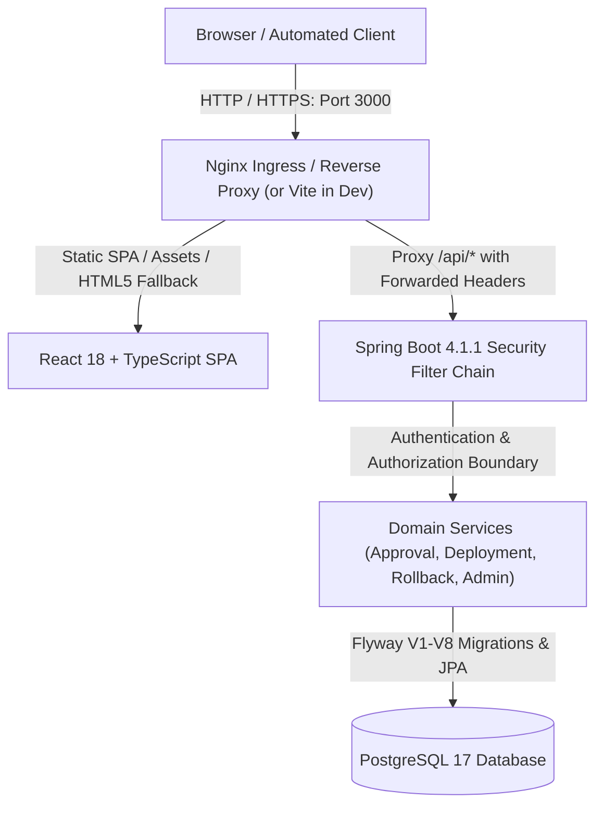

# Multi-Role Authentication, Authorization, and Single Ingress Architecture

## 1. Overview & Architectural Principles

ReleaseGuard enforces enterprise-grade role-based access control (RBAC), state-changing CSRF defense, server-side session management, and single-ingress reverse proxy routing.



### Key Invariants
1. **Server-Side Identity Derivation**: All audit trails (`actor`, `actorUserId`, `deployedBy`, `deployedByUserId`) are strictly derived from the authenticated security principal (`Authentication`). Caller-supplied client audit strings are ignored or rejected.
2. **Immutable Governance Policies**: Administrative privileges do not permit bypassing release status state machines, missing SBOM evidence checks, or the strict production deployment approval policy (`release-policy-v1`).
3. **Session & Fixation Protection**: Server-side sessions are managed via standard HttpOnly session cookies (`RELEASEGUARD_SESSION`) with `SameSite=Lax`. Session identifiers are rotated upon login (`migrateSession()`).
4. **Defense in Depth**: Authorization is enforced at the HTTP request layer in `SecurityConfig`, at the method/service layer for mutations, and at the action level for the polymorphic `POST /api/v1/applications/{appId}/releases/{relId}/decisions` endpoint.
5. **Brute-Force Rate Limiting**: Repeated failed login attempts are tracked per-user/IP via `LoginAttemptService`. Reaching the 5-attempt threshold triggers an immediate HTTP 429 (`Too Many Requests`) temporary lockout.

---

## 2. Role Model and Permission Matrix

ReleaseGuard supports 5 primary roles. Multiple roles can be assigned to a single account:

| Feature / Endpoint | VIEWER | DEVELOPER | REVIEWER | DEPLOYER | ADMIN | Notes |
| :--- | :---: | :---: | :---: | :---: | :---: | :--- |
| **Read Applications & Releases** (`GET /api/v1/applications/**`) | ✅ | ✅ | ✅ | ✅ | ✅ | Unauthenticated returns 401 |
| **Read SBOM Inventory & Components** (`GET /api/v1/.../sbom/**`) | ✅ | ✅ | ✅ | ✅ | ✅ | Paginated CycloneDX inventory |
| **Read Dependency Comparison** (`GET /api/v1/.../compare/**`) | ✅ | ✅ | ✅ | ✅ | ✅ | Diff between two releases |
| **Read Vulnerability Findings** (`GET /api/v1/.../findings/**`) | ✅ | ✅ | ✅ | ✅ | ✅ | Paginated CVEs and severities |
| **Read Deployment & Decision History** (`GET /api/v1/.../deployments/**`) | ✅ | ✅ | ✅ | ✅ | ✅ | Includes current environment pointers |
| **Register Application** (`POST /api/v1/applications`) | ❌ (403) | ✅ | ❌ (403) | ❌ (403) | ✅ | DEVELOPER or ADMIN required |
| **Register Release** (`POST /api/v1/applications/{id}/releases`) | ❌ (403) | ✅ | ❌ (403) | ❌ (403) | ✅ | Requires full Git commit SHA |
| **Upload CycloneDX SBOM** (`POST .../sbom`) | ❌ (403) | ✅ | ❌ (403) | ❌ (403) | ✅ | Multipart upload with CSRF token |
| **Upload Vulnerability Scan** (`POST .../vulnerability-imports`) | ❌ (403) | ✅ | ❌ (403) | ❌ (403) | ✅ | Trivy/Grype JSON upload |
| **Submit Draft for Review** (`POST .../decisions` with `SUBMIT`) | ❌ (403) | ✅ | ❌ (403) | ❌ (403) | ✅ | Action-level authorization |
| **Approve / Reject Release** (`POST .../decisions` with `APPROVE`/`REJECT`) | ❌ (403) | ❌ (403) | ✅ | ❌ (403) | ✅ | Action-level authorization |
| **Revoke / Retire Release** (`POST .../decisions` with `REVOKE`/`RETIRE`) | ❌ (403) | ❌ (403) | ✅ | ❌ (403) | ✅ | Action-level authorization |
| **Record Deployment** (`POST .../deployments`) | ❌ (403) | ❌ (403) | ❌ (403) | ✅ | ✅ | PRODUCTION requires valid approval |
| **Record Atomic Rollback** (`POST .../deployments/rollbacks`) | ❌ (403) | ❌ (403) | ❌ (403) | ✅ | ✅ | Validates expected current pointer |
| **Manage Users & Roles** (`/api/v1/admin/users/**`) | ❌ (403) | ❌ (403) | ❌ (403) | ❌ (403) | ✅ | Protected from deleting last admin |

---

## 3. Authentication, Session & CSRF Workflow

### 1. CSRF Token Exchange
- The browser fetches `/api/v1/auth/csrf` (or any GET endpoint).
- Spring Security's `CookieCsrfTokenRepository.withHttpOnlyFalse()` issues an `XSRF-TOKEN` cookie readable by the frontend JavaScript client.
- For all state-changing requests (`POST`, `PUT`, `DELETE`, `PATCH`), the API client attaches the token in the `X-XSRF-TOKEN` HTTP header.

### 2. Login Flow
- **Endpoint**: `POST /api/v1/auth/login`
- **Request Body**:
  ```json
  {
    "username": "admin",
    "password": "ChosenPassword"
  }
  ```
- **Response**:
  - `200 OK` with user details and roles:
    ```json
    {
      "id": 1,
      "username": "admin",
      "displayName": "System Administrator",
      "roles": ["ADMIN"],
      "enabled": true
    }
    ```
  - `Set-Cookie: RELEASEGUARD_SESSION=...; Path=/; HttpOnly; SameSite=Lax`
- **Rate Limiting**: After 5 consecutive invalid authentication attempts, the username is locked for 15 minutes, returning:
  `HTTP 429 Too Many Requests: {"status": 429, "error": "Too Many Requests", "path": "/api/v1/auth/login"}`

### 3. Session Validation
- **Endpoint**: `GET /api/v1/auth/me`
- Evaluates the session cookie. If valid, returns the active principal's identity and roles.
- If expired or missing, returns `HTTP 401 Unauthorized` with a structured JSON body (no HTML redirect).

### 4. Logout Flow
- **Endpoint**: `POST /api/v1/auth/logout`
- Invalidates the HTTP session on the server, clears the security context, and expires the session cookie.

---

## 4. Account Provisioning and Administration

### Secure Initial Administrator Bootstrap
The initial administrator account is provisioned automatically on startup if no active administrator exists in the database.

- **Username**: Configured via `SECURITY_INITIAL_ADMIN_USERNAME` (defaults to `admin`).
- **Password**: Configured via environment variable `SECURITY_INITIAL_ADMIN_PASSWORD` (or `INITIAL_ADMIN_PASSWORD`).
- **Security Safeguards**:
  - If an active administrator already exists in the database (`countActiveAdmins() > 0`), the bootstrap process skips account creation and never alters or overwrites existing credentials on restarts.
  - Plaintext passwords are never logged, committed to version control, or returned via APIs.
  - Passwords are encrypted using BCrypt (`BCryptPasswordEncoder`).

### Test Account Seeding
For verification environments, test accounts representing each role can be seeded by setting:
```bash
SECURITY_SEED_TEST_ACCOUNTS=true
SECURITY_TEST_ACCOUNTS_PASSWORD=<YourSecureTestPassword>
```
This provisions:
- `viewer` (`VIEWER`)
- `developer` (`DEVELOPER`)
- `reviewer` (`REVIEWER`)
- `deployer` (`DEPLOYER`)

### Resetting Administrator Passwords Securely
1. **Via Admin API (Self-Service by Active Admin)**:
   ```bash
   POST /api/v1/admin/users/{userId}/password
   Content-Type: application/json
   X-XSRF-TOKEN: <token>
   Cookie: RELEASEGUARD_SESSION=<admin_session>

   { "newPassword": "<NewSecurePassword>" }
   ```
2. **Disaster Recovery (Database Direct)**:
   If access is lost and no admin credentials are known:
   ```bash
   # Generate a BCrypt hash for the new password and update in PostgreSQL:
   docker exec -it releaseguard-postgres psql -U releaseguard -d releaseguard -c \
     "UPDATE users SET password_hash = '<new_bcrypt_hash>' WHERE username = 'admin';"
   ```

### Last Active Administrator Protection
The `AdminUserService` strictly enforces that the final active administrator cannot be deleted or disabled, nor can their `ADMIN` role be revoked. Any attempt returns `HTTP 409 Conflict`.

---

## 5. Single Ingress Reverse Proxy Architecture

The single entry point for all browser client interactions is Nginx listening on port 3000 (or Vite in local development mode proxying `/api`).

### Ingress Configuration Highlights (`frontend/nginx.conf`)
- **Single Origin**: All frontend assets and backend APIs are served under `http://localhost:3000`.
- **Upload Body Size Limit**: Configured to `12M` (`client_max_body_size 12M;`) to accommodate CycloneDX 1.6 SBOM JSON files and large vulnerability reports.
- **Proxy Headers**:
  ```nginx
  proxy_set_header Host $host;
  proxy_set_header X-Real-IP $remote_addr;
  proxy_set_header X-Forwarded-For $proxy_add_x_forwarded_for;
  proxy_set_header X-Forwarded-Proto $scheme;
  ```
- **Backend Header Trust**: The Spring Boot backend enables `server.forward-headers-strategy=framework` to parse standard forwarded headers.
- **SPA Fallback Boundary**: The static SPA fallback `try_files $uri $uri/ /index.html;` only applies to non-API routes. `/api/` requests are proxied directly to the backend container, ensuring 401/403/404 errors return JSON error payloads rather than HTML.
- **Port Isolation**: In production compose mode, the database (`postgres`) and Spring Boot (`backend`) are kept on the private internal bridge network (`releaseguard-network`), preventing public host port exposure.

---

## 6. Legacy Audit Data Preservation

Existing deployment and decision audit records created before the V8 migration feature caller-supplied audit strings (e.g., `Planner Team`, `ci-runner`, `incident-commander`).

- The Flyway migration `V8__create_users_and_roles.sql` added nullable `actor_user_id` and `deployed_by_user_id` foreign keys to `release_decisions` and `deployments`.
- Legacy records remain 100% intact with their original string identifiers preserved.
- New actions executed by authenticated principals record both the readable formatted snapshot (e.g., `"Demo Deployer (deployer)"`) and the permanent database foreign key link to the user record.
- Updating a user's display name does not alter or rewrite historical audit records.
